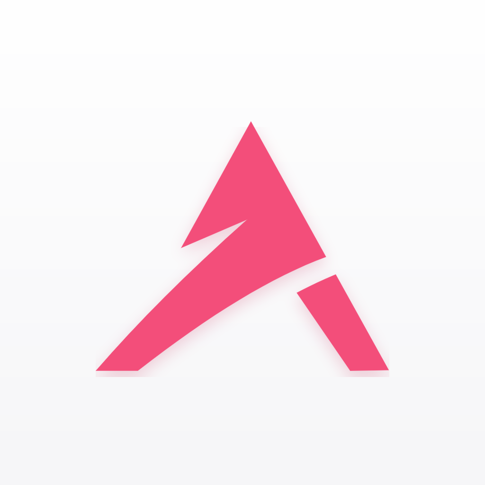

  

<h1 align="center">Alpha-AI</h1>

<b>A local-first ecosystem for working with a team of AI agents.</b>

Alpha-AI builds tools that keep day-to-day work, the people doing it and a small team of AI agents in one place. Our products are in active development (alpha). We publish repositories here when they are ready to share.

The "A" in our mark is the first letter of every product name: Todo-T**A**sk and **A**gent-roster.

## Products

| | Product | What it is |
|---|---|---|
|  | **Todo-Task** | A local task dashboard for Jira-style work: Overview, Board, List, History, Activity, Calendar, Mail and Habits, plus local projects with their own boards. A task opens into a checklist, merge requests, an AI insight and Confluence context. Jira and Confluence are read-only. Runs on your machine. |
|  | **Agent-roster** | A small team of AI agents (a BA, a CTO and Managers) that run locally in terminal panes, take assignments, ask each other under strict rules and report back. One local server is the only writer of agent state. Guards block risky file and git actions, and an analyst flags blocked work. Loopback only. |
|  | **TodoApp** (iPhone) | A SwiftUI companion that mirrors Todo-Task and Agent-roster on your phone, shows agent conversations as chat and sends only allow-listed commands back through a local bridge. Login required. |

## How they fit together

Agent-roster agents receive their work from Todo-Task. TodoApp mirrors both on the phone. The two desktop products run locally. The phone app syncs through a private, authenticated channel, so it is the one place where data leaves the machine, by design.

## Status

Everything here is alpha. Interfaces, names and behaviour will change. There are no public releases yet.

## Contact

Contact details will be added here.
